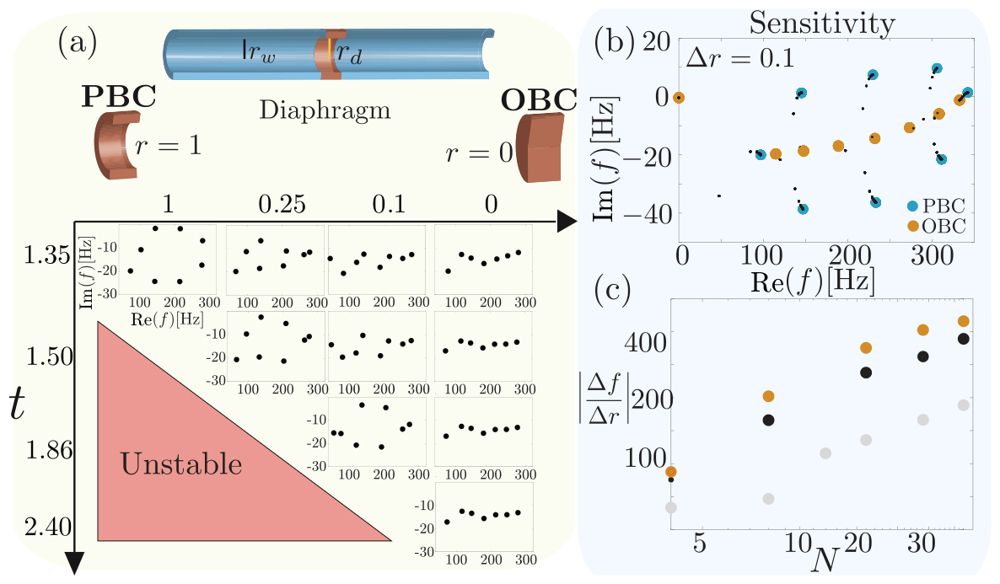
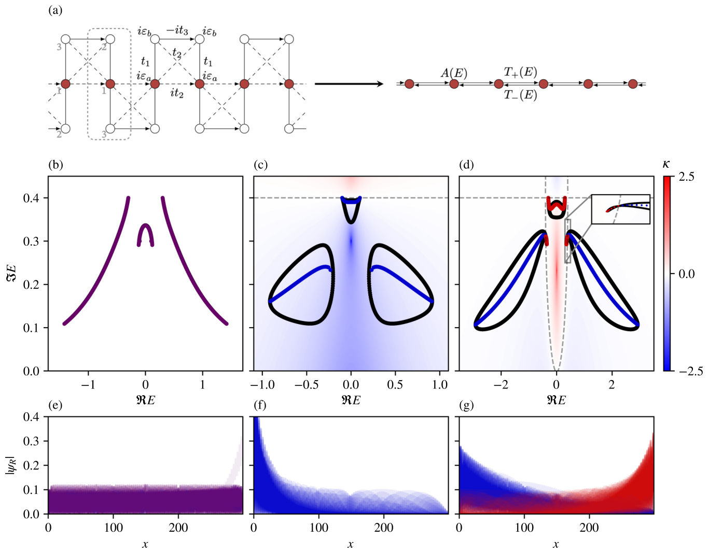
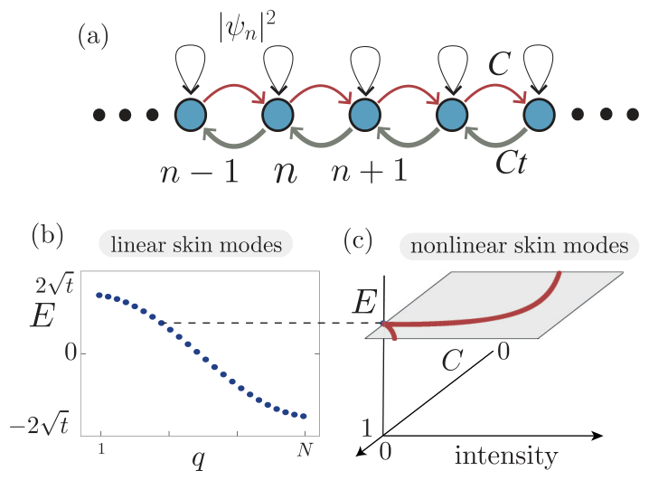
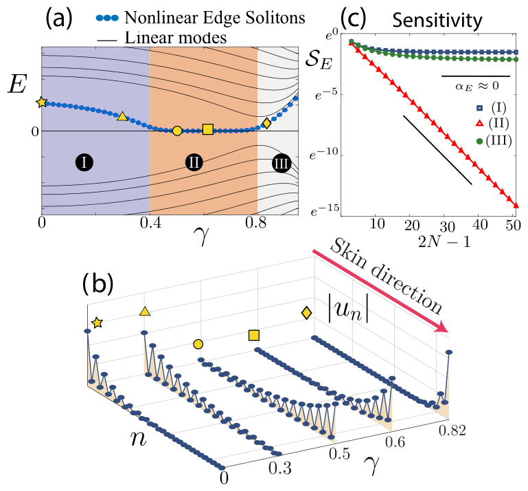
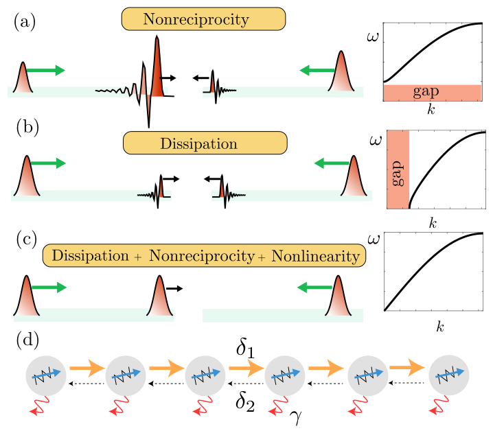

Figure: acoustic Hatano–Nelson lattice with active feedback (top) and measured pressure of the modes: reciprocal case vs. skin effect, with all modes localised at one end. From A. Maddi <i>et al.</i>, Phys. Rev. Research <b>6</b>, L012061 (2024), Fig. 3.

In lattices with nonreciprocal couplings, such as the Hatano–Nelson model, the bulk eigenmodes accumulate at one boundary (the non-Hermitian skin effect), and the spectrum is exponentially sensitive to the boundary conditions. We realised an **exact acoustic analogue of the Hatano–Nelson model** in continuous waveguides with active feedback, observed the skin effect experimentally, and measured the transition between periodic and open boundary conditions. We also study how the skin effect emerges in effective models of more complex lattices, and how it combines with **nonlinearity**: nonlinear skin modes, insensitive edge solitons, and solitonic pulses that tame the skin-effect growth.

## Papers

1. 
   Fig. 5 of the paper: PBC → OBC transition with a diaphragm, and exponential sensitivity.

   A. Maddi, Y. Aurégan, G. Penelet, V. Pagneux, and V. Achilleos,
   *Exact analog of the Hatano-Nelson model in one-dimensional continuous nonreciprocal systems*,
   Phys. Rev. Research **6**, L012061 (2024).
   [Paper](https://doi.org/10.1103/PhysRevResearch.6.L012061)

2. 
   Fig. 2 of the paper: emergent Hatano–Nelson model and bipolar skin effect.

   L. Eek, A. Moustaj, M. Röntgen, V. Pagneux, V. Achilleos, and C. Morais Smith,
   *Emergent non-Hermitian models*,
   Phys. Rev. B **109**, 045122 (2024).
   [Paper](https://doi.org/10.1103/PhysRevB.109.045122)

3. 
   Fig. 1 of the paper: nonlinear Hatano–Nelson model, linear and nonlinear skin modes.

   B. Many Manda, R. Carretero-González, P. G. Kevrekidis, and V. Achilleos,
   *Skin modes in a nonlinear Hatano-Nelson model*,
   Phys. Rev. B **109**, 094308 (2024).
   [Paper](https://doi.org/10.1103/PhysRevB.109.094308) · [arXiv](https://arxiv.org/abs/2311.09139)

4. 
   Fig. 3 of the paper: energy of nonreciprocal edge solitons vs nonreciprocity, and its insensitivity to the boundary.

   B. Many Manda and V. Achilleos,
   *Insensitive edge solitons in a non-Hermitian topological lattice*,
   Phys. Rev. B **110**, L180302 (2024).
   [Paper](https://doi.org/10.1103/PhysRevB.110.L180302)

5. 
   Fig. 1 of the paper: taming pulse propagation with dissipation, nonreciprocity and nonlinearity.

   S. Jana, B. Many Manda, V. Achilleos, D. J. Frantzeskakis, and L. Sirota,
   *Harnessing nonlinearity to tame wave dynamics in nonreciprocal active systems*,
   Phys. Rev. Applied **24**, L041005 (2025).
   [Paper](https://doi.org/10.1103/PhysRevApplied.24.L041005) · [arXiv](https://arxiv.org/abs/2502.16216)

Figures reproduced from the published articles (© American Physical Society) for illustration; see the original papers for details.

